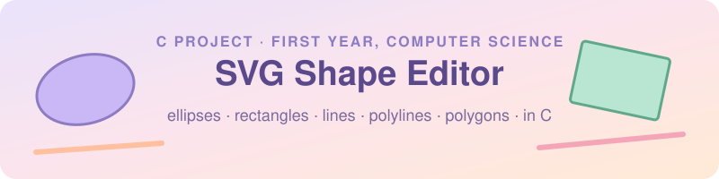
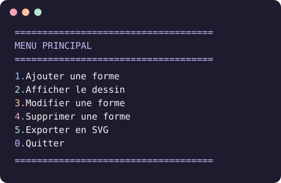

<p align="center">
  
</p>

<p align="center">
  
  
  
</p>

<p align="center">
  🇫🇷 <a href="README.md">Français</a> · 🇬🇧 <b>English</b>
</p>

<h1 align="center">🎓 C Project · First Year, Computer Science (B1)</h1>

<h2 align="center">🎨 SVG Shape Editor</h2>

<p align="center">
  <b>A command-line shape editor, written in C.</b><br>
  From a colourful menu, you can create ellipses and circles, rectangles and squares,<br>
  lines, polylines and polygons,<br>
  edit or delete them, then export the drawing to an <code>.svg</code> file you can open in a browser.
</p>

> [!NOTE]
> **How does it work?** The program doesn't draw anything itself: it **writes text** in SVG format. The browser reads that text and draws the shapes.

---

## ✨ Features

- Add one of five shapes:
  - **ellipse** (or circle)
  - **rectangle** (or square)
  - **line**
  - **polyline**: a series of connected points (at least 2)
  - **polygon**: a closed polyline, where the last point joins the first (at least 3)
- Give each shape a style: fill colour, outline colour, translation, rotation and flip (mirror along the X or Y axis)
- Display every shape in the drawing with its slot number
- Edit or delete a shape
- Export the drawing to **SVG**, readable by any browser
- A pastel-coloured menu in the terminal (lavender, mint, peach, pink)

Example of a generated file:

```xml
<svg xmlns='http://www.w3.org/2000/svg' width='800' height='600' viewBox='0 0 800 600'>
  <rect x='10' y='20' width='100' height='50' fill='red' stroke='black' transform='translate(0 0) rotate(0 60 45) translate(60 45) scale(1 1) translate(-60 -45)' />
  <polygon points='10,10 100,50 60,120 ' fill='none' stroke='purple' transform='translate(0 0) rotate(0 56 60) translate(56 60) scale(-1 1) translate(-56 -60)' />
</svg>
```

> 💡 In SVG, polylines and polygons are filled in black by default. To keep only the outline, type `none` as the fill colour.

---

## 📋 The assignment and what I'm handing in

### What was asked

The assignment asked for a program to **create, edit, save, load and display** vector drawings in SVG format, with:

- **shapes**: ellipse and circle, rectangle and square, line, polyline, polygon, paths and groups;
- **styles**: fill and outline colours, translation, rotation, flip along the X or Y axis.

This was my first project, and I started it with no background in algorithms or in C. It isn't complete, but I'm happy with how far I've come.

### Where I stand

| Required by the assignment     | Status | In my project                                         |
|--------------------------------|:------:|-------------------------------------------------------|
| Create                         | ✅     | "Add a shape" menu                                    |
| Edit                           | ✅     | "Edit" and "Delete a shape" menus                     |
| Export                         | ✅     | Drawing exported to an `.svg` file                    |
| Save                           | ❌     | Not done yet: the drawing is lost when the program closes |
| Load                           | ❌     | Not done yet                                          |
| Display                        | ✅     | Shown in the terminal, and SVG opened in the browser  |
| Ellipse / circle               | ✅     | `ellipse.c`                                           |
| Rectangle / square             | ✅     | `rectangle.c`                                         |
| Line                           | ✅     | `line.c`                                              |
| Polyline                       | ✅     | `polyline.c`                                          |
| Polygon                        | ✅     | `polygon.c`                                           |
| Paths (`<path>`)               | ❌     | Not done yet                                          |
| Groups (`<g>`)                 | ❌     | Not done yet                                          |
| Colours, translation, rotation | ✅     | `style.c`                                             |
| Flip on X / Y axis             | ✅     | `flip` field in the style                             |

### What's missing

1. **Saving a drawing.** My program can export an SVG file, but it can't yet store the drawing so it's kept after closing.
2. **Loading a drawing.** It also can't read a file back to recreate the shapes. Together with saving, these are the most important gaps, because they're part of the assignment's main sentence.
3. **Paths**, the `<path>` tag: a shape described by a series of instructions, like "go here", "draw a line to there" or "make a curve".
4. **Groups**, the `<g>` tag: several shapes put together, sharing the same style.

---

## 🛠️ Requirements

Before running the project, you need:

| Tool | What it's for | How to check |
|------|---------------|--------------|
| **C compiler** (C99) | Turn the code into a program | `gcc-16 --version` |
| **make** | Compile with a single command | `make --version` |
| **A browser** | Open and view the `.svg` file | Chrome, Firefox, Safari… |
| **leaks** *(optional, macOS)* | Check there are no memory leaks | `leaks --help` |

> 💡 The Makefile uses `gcc-16`. If you have another version, change the `CC` variable at the top of the Makefile (for example `CC = gcc`).

---

## 🚀 Installation and launch

```bash
git clone <https://github.com/lilouwalkowiak/Projet-C-B1-.git>
cd Projet-C-B1-
make build   # compiles the project and creates the main program
make run     # compiles if needed, then runs ./main
```

| Command      | What it does                                   |
|--------------|------------------------------------------------|
| `make build` | Compiles the project and creates `main`        |
| `make run`   | Compiles if needed, then runs the program      |
| `make clean` | Deletes the executable to start fresh          |

The project is compiled with `-std=c99 -Wall -Wextra -Wpedantic`: these options ask the compiler to report as many potential errors as possible.

---

## 🖱️ Usage

When it starts, the main menu appears (the program itself is in French):

<p align="center">
  
</p>

1. Type `1` (*Ajouter une forme*, add a shape), choose a slot (0 to 49), then the shape type (1 to 5) and its values. For a polyline or a polygon, the program first asks for the number of points, then each point one by one.
2. Add as many shapes as you like.
3. Type `5` (*Exporter en SVG*, export to SVG) and give the file a name, for example `drawing.svg`.
4. Open it in your browser:

```bash
open -a "Google Chrome" drawing.svg   # macOS
```

Shapes are drawn in slot order: the one in slot 49 appears on top of the one in slot 0.

---

## 🧪 Checking memory

```bash
leaks --atExit -- ./main
```

The goal is to reach **0 leaks**, meaning every `malloc` has its matching `free`.

---

## 📁 Project structure

```
.
├── main.c          # the menu and main loop
├── Makefile
├── includes/       # the .h files: structures and prototypes
└── src/
    ├── point.c     # a point (x, y)
    ├── style.c     # colours, translation, rotation, flip
    ├── ellipse.c   # an ellipse (centre + two radii)
    ├── rectangle.c # a rectangle (corner + length + width)
    ├── line.c      # a line (start + end)
    ├── polyline.c  # a polyline (array of points + their count)
    ├── polygon.c   # a polygon (same, but closed)
    ├── shape.c     # any shape (type + union)
    ├── viewport.c  # the drawing window (800 × 600 by default)
    ├── drawing.c   # the drawing: an array of 50 slots
    ├── svg.c       # export to an SVG file
    └── utils.c     # safe keyboard input
```

The structures fit inside each other like Russian dolls:

```
drawing_t (the drawing)
 ├── viewport_t (width, height)
 └── array of 50 slots
      └── shape_t (a type + a union)
           ├── ellipse_t   ─┐
           ├── rectangle_t  │
           ├── line_t       ├── each one holds point_t + a styles_t
           ├── polyline_t   │
           └── polygon_t   ─┘
```

Polylines and polygons don't have a fixed number of points. So they keep an array of point addresses (`point_t **points`) and a counter (`count`), because in C an array doesn't know its own size.

```
polyline ──► [ points ──► [ address | address | address ... ]
               count = 3
               styles ──► [ ... ] ]
```

Every part of the program has the same five functions: `create_`, `ask_for_`, `modify_`, `print_`, `free_`. Once I had understood one, it was easier to understand the others.

---

## 🤔 My choices

### Code organisation

- **One file per concept**: the point, the style, each shape, the drawing, the SVG export… each has its own `.h` and `.c`.
  - The `.h` (in `includes/`) is the "ID card": the structure and the list of functions.
  - The `.c` (in `src/`) contains the code of those functions.
  - `main.c` stays at the root and only handles the menu.

  This split let me work on one concept at a time, find any function easily, and fix one part without breaking the others.
- **A single box for every shape** (`shape_t`). It contains:
  - a `type`, which says what kind of shape it is (ellipse, rectangle…);
  - a `union`, which holds the shape itself.

  This way, all five shapes fit in the same array. And adding a shape, as I did for the polyline and the polygon, only takes three small steps: add its name to the `enum`, a field to the `union`, and a `case` to each `switch`.
- **A circle is an ellipse, a square is a rectangle**: less code, so fewer mistakes.
- **The flip is stored in the style**, as an integer `flip` (0: none, 1: X axis, 2: Y axis). Since every shape uses the same style, they all got the flip without me touching their files.
- **All the export code in `svg.c`**: to switch format one day, only one file would need changing.

### Memory

- **An array of 50 slots created with `calloc`**: every slot starts empty (`NULL`), and deleting a shape doesn't shift the others.
- **Points allocated at the right size** for polylines and polygons: the user chooses how many they want, so I allocate exactly that number.
- **Each shape frees its own parts**, from the inside out: first the points, then the array, then the style, and finally the shape itself.

### User input

- **Safe keyboard input** (`ask_for_int` in `utils.c`): if the user types something that isn't a number, the program asks again instead of crashing.
- **Values checked before being used**: at least 2 points for a polyline, 3 for a polygon, a point number that exists, a flip between 0 and 2. If something is wrong, the program asks again rather than making up a value, and it never reads outside an array.

---

## 💭 The story of this project

When we were given this project, I had no background in algorithms or in C. I didn't know where to start or which functions to use, and I was convinced I'd never manage.

What got me unstuck:

- **the project tree shown by our instructor**, which taught me to split the project into pieces;
- **his examples**: he started the code, we carried on ourselves, and I built the rest from there;
- **one building block at a time**: the point, the style, each shape, the drawing, the menu, then the SVG export, testing each part before moving on.

I learned a lot along the way, and I'm still making progress.

---

## 📚 What I learned

Here are a few examples of what this project taught me:

- **What a pointer is for**: it holds the address of a piece of data. This makes it possible to:
  - change the real data inside a function, not a copy (for example, `modify_point` receives the point's address and changes it directly);
  - share a structure without copying it every time;
  - use the memory reserved with `malloc`, which returns an address.
- Reserving and freeing memory, and why the order of the `free` calls matters
- Protecting `.h` files with `#ifndef`, so they aren't read twice
- The SVG format: `fill`, `stroke`, `transform`, `viewBox`, and the fact that transformations apply from right to left
- That well-organised code is easy to extend: the polyline, the polygon and the flip were added without breaking anything
- **Reading compiler errors**: look at the *first* error, the file name and the line number, fix it, then recompile

---

## 🚧 Known limitations

On top of the four gaps listed above, here's what could be better:

- No more than **50 shapes** in a drawing
- The drawing size is fixed at 800 × 600
- **Negative sizes** and **invalid colours** aren't rejected
- Text input can't contain spaces

---

## 🔮 If I had more time

- **Loading an SVG file**: doing the export in reverse. The program would read the file line by line, recognise each shape (`<rect` for a rectangle, `<ellipse` for an ellipse…), get its values (position, size, colours) and recreate it in the drawing.
- **Better saving**: offering to save the drawing before quitting, so it's never lost by mistake, and being able to reopen it later thanks to loading.
- **Paths**: a shape that keeps a list of instructions (a letter and a point), on the same principle as the polyline's array of points.
- **Groups**: a shape that itself contains an array of shapes, with a shared style.
- Being able to change the drawing size from the menu.

---

## 🙏 Thanks

Thank you to our instructor, [Thomas Hodson](https://www.linkedin.com/in/thomas-hodson/), who showed us how to split the project and guided us with his examples. Without that starting point, I'm not sure I would have dared to begin.

Thank you also to my classmates, who helped me throughout the project.

### 📖 Resources used

- **The course**
- **The book *Programmer en C pour les Nuls*** (*C Programming For Dummies*, French edition), for the basics of the language
- **The [MDN](https://developer.mozilla.org/en-US/docs/Web/SVG) SVG documentation**, for the tags and transformations
- **An AI**, used as a tutor: to explain concepts I didn't understand, show me code examples, check whether my code was correct, and help me understand compiler errors when I was stuck

---

<p align="center">
  <i>Project by Lilou, October 2026.</i>
</p>

<p align="center">
  <a href="https://www.linkedin.com/in/lilou-walkowiak/">
    
  </a>
</p>