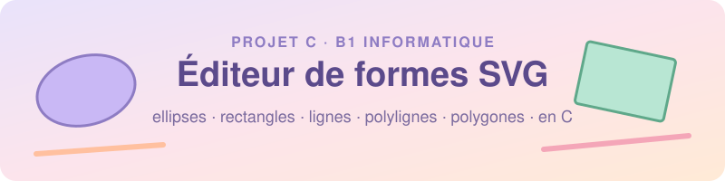

<p align="center">
  
</p>

<p align="center">
  
  
  
</p>

<p align="center">
  🇫🇷 <b>Français</b> · 🇬🇧 <a href="README.en.md">English</a>
</p>

<h1 align="center">🎓 Projet C · B1 Informatique</h1>

<h2 align="center">🎨 Éditeur de formes SVG</h2>

<p align="center">
  <b>Un éditeur de formes en ligne de commande, écrit en C.</b><br>
  Depuis un menu coloré, on crée des ellipses et des cercles, des rectangles et des carrés,<br>
  des lignes, des polylignes et des polygones,<br>
  on les modifie ou on les supprime, puis on exporte le dessin dans un fichier <code>.svg</code> à ouvrir dans un navigateur.
</p>

> [!NOTE]
> **Comment ça marche ?** Le programme ne dessine rien lui-même : il **écrit du texte** au format SVG. C'est le navigateur qui lit ce texte et dessine les formes.

---

## ✨ Fonctionnalités

- Ajouter une forme parmi cinq :
  - **ellipse** (ou cercle)
  - **rectangle** (ou carré)
  - **ligne**
  - **polyligne** : une suite de points reliés entre eux (au moins 2)
  - **polygone** : une polyligne fermée, dont le dernier point rejoint le premier (au moins 3)
- Donner un style à chaque forme : couleur de remplissage, couleur de contour, translation, rotation et inversion (miroir selon l'axe X ou Y)
- Afficher toutes les formes du dessin avec leur numéro de case
- Modifier ou supprimer une forme
- Exporter le dessin en **SVG**, lisible par n'importe quel navigateur
- Un menu en couleurs pastel dans le terminal (lavande, menthe, pêche, rose)

Exemple de fichier produit :

```xml
<svg xmlns='http://www.w3.org/2000/svg' width='800' height='600' viewBox='0 0 800 600'>
  <rect x='10' y='20' width='100' height='50' fill='red' stroke='black' transform='translate(0 0) rotate(0 60 45) translate(60 45) scale(1 1) translate(-60 -45)' />
  <polygon points='10,10 100,50 60,120 ' fill='none' stroke='purple' transform='translate(0 0) rotate(0 56 60) translate(56 60) scale(-1 1) translate(-56 -60)' />
</svg>
```

> 💡 En SVG, une polyligne et un polygone sont remplis en noir par défaut. Pour ne garder que le trait, tapez `none` comme couleur de remplissage.

---

## 📋 Le sujet et ce que je rends

### Ce qui était demandé

Le sujet demandait un programme pour **créer, éditer, sauver, charger et visualiser** des dessins vectoriels au format SVG, avec :

- des **formes** : ellipse et cercle, rectangle et carré, ligne, polyligne, polygone, chemins (trajectoires) et groupes ;
- des **styles** : couleurs de remplissage et de contour, translation, rotation, inversion selon l'axe X ou Y.

C'était mon premier projet, et je l'ai commencé sans aucune base en algorithmique ni en langage C. Il n'est pas complet, mais je suis contente du chemin parcouru.

### Où j'en suis

| Demandé dans le sujet           | État | Dans mon projet                                              |
|---------------------------------|:----:|--------------------------------------------------------------|
| Créer                           | ✅   | Menu « Ajouter une forme »                                   |
| Éditer                          | ✅   | Menus « Modifier » et « Supprimer une forme »                |
| Exporter                        | ✅   | Export du dessin en fichier `.svg`                           |
| Sauvegarder                     | ❌   | Pas encore fait : le dessin est perdu à la fermeture         |
| Charger                         | ❌   | Pas encore fait                                              |
| Visualiser                      | ✅   | Affichage dans le terminal, et SVG ouvert dans le navigateur |
| Ellipse / cercle                | ✅   | `ellipse.c`                                                  |
| Rectangle / carré               | ✅   | `rectangle.c`                                                |
| Ligne                           | ✅   | `line.c`                                                     |
| Polyligne                       | ✅   | `polyline.c`                                                 |
| Polygone                        | ✅   | `polygon.c`                                                  |
| Chemins (`<path>`)              | ❌   | Pas encore fait                                              |
| Groupes (`<g>`)                 | ❌   | Pas encore fait                                              |
| Couleurs, translation, rotation | ✅   | `style.c`                                                    |
| Inversion axe X / Y             | ✅   | Champ `flip` dans le style                                   |

### Ce qui me manque

1. **Sauvegarder un dessin.** Mon programme sait exporter un fichier SVG, mais pas encore enregistrer le dessin pour le garder après la fermeture.
2. **Charger un dessin.** Il ne sait pas non plus relire un fichier pour recréer les formes. Avec la sauvegarde, ce sont les manques les plus importants, car ils font partie de la phrase principale du sujet.
3. **Les chemins**, la balise `<path>` : une forme décrite par une suite d'instructions, comme « va ici », « trace une ligne jusque-là » ou « fais une courbe ».
4. **Les groupes**, la balise `<g>` : plusieurs formes réunies, qui partagent le même style.

---

## 🛠️ Prérequis

Avant de lancer le projet, il faut avoir installé :

| Outil | À quoi il sert | Comment vérifier |
|-------|----------------|------------------|
| **Compilateur C** (C99) | Transformer le code en programme | `gcc-16 --version` |
| **make** | Compiler avec une seule commande | `make --version` |
| **Un navigateur** | Ouvrir et voir le fichier `.svg` | Chrome, Firefox, Safari… |
| **leaks** *(optionnel, macOS)* | Vérifier qu'il n'y a pas de fuite mémoire | `leaks --help` |

> 💡 Le Makefile utilise `gcc-16`. Si vous avez une autre version, changez la variable `CC` en haut du Makefile (par exemple `CC = gcc`).

---

## 🚀 Installation et lancement

```bash
git clone <https://github.com/lilouwalkowiak/Projet-C-B1-.git>
cd Projet-C-B1-
make build   # compile le projet et crée le programme main
make run     # compile si besoin, puis lance ./main
```

| Commande     | Ce qu'elle fait                                |
|--------------|------------------------------------------------|
| `make build` | Compile le projet et crée l'exécutable `main`  |
| `make run`   | Compile si besoin, puis lance le programme     |
| `make clean` | Supprime l'exécutable pour repartir de zéro    |

Le projet est compilé avec `-std=c99 -Wall -Wextra -Wpedantic` : ces options demandent au compilateur de signaler le plus d'erreurs possibles.

---

## 🖱️ Utilisation

Au lancement, le menu principal s'affiche :

<p align="center">
  
</p>

1. Tapez `1`, choisissez une case (de 0 à 49), puis le type de forme (de 1 à 5) et ses valeurs. Pour une polyligne ou un polygone, le programme demande d'abord le nombre de points, puis chaque point un par un.
2. Ajoutez autant de formes que vous voulez.
3. Tapez `5` et donnez un nom au fichier, par exemple `dessin.svg`.
4. Ouvrez-le dans votre navigateur :

```bash
open -a "Google Chrome" dessin.svg   # macOS
```

Les formes sont dessinées dans l'ordre des cases : celle de la case 49 passe par-dessus celle de la case 0.

---

## 🧪 Vérifier la mémoire

```bash
leaks --atExit -- ./main
```

L'objectif est d'arriver à **0 leaks**, c'est-à-dire que chaque `malloc` ait bien son `free`.

---

## 📁 Structure du projet

```
.
├── main.c          # le menu et la boucle principale
├── Makefile
├── includes/       # les .h : structures et prototypes
└── src/
    ├── point.c     # un point (x, y)
    ├── style.c     # couleurs, translation, rotation, inversion
    ├── ellipse.c   # une ellipse (centre + deux rayons)
    ├── rectangle.c # un rectangle (coin + longueur + largeur)
    ├── line.c      # une ligne (début + fin)
    ├── polyline.c  # une polyligne (tableau de points + leur nombre)
    ├── polygon.c   # un polygone (pareil, mais fermé)
    ├── shape.c     # une forme quelconque (type + union)
    ├── viewport.c  # la fenêtre du dessin (800 × 600 par défaut)
    ├── drawing.c   # le dessin : un tableau de 50 cases
    ├── svg.c       # l'export en fichier SVG
    └── utils.c     # lecture clavier sécurisée
```

Les structures s'emboîtent comme des poupées russes :

```
drawing_t (le dessin)
 ├── viewport_t (largeur, hauteur)
 └── tableau de 50 cases
      └── shape_t (un type + une union)
           ├── ellipse_t   ─┐
           ├── rectangle_t  │
           ├── line_t       ├── chacune contient des point_t + un styles_t
           ├── polyline_t   │
           └── polygon_t   ─┘
```

La polyligne et le polygone n'ont pas un nombre de points fixe. Ils gardent donc un tableau d'adresses de points (`point_t **points`) et un compteur (`count`), car en C un tableau ne connaît pas sa propre taille.

```
polyline ──► [ points ──► [ adresse | adresse | adresse ... ]
               count = 3
               styles ──► [ ... ] ]
```

Chaque notion a les mêmes cinq fonctions : `create_`, `ask_for_`, `modify_`, `print_`, `free_`. Une fois que j'en avais compris une, c'était plus facile de comprendre les autres.

---

## 🤔 Mes choix

### Organisation du code

- **Un fichier par notion** : le point, le style, chaque forme, le dessin, l'export SVG… ont chacun leur `.h` et leur `.c`.
  - Le `.h` (dans `includes/`) est la « carte d'identité » : la structure et la liste des fonctions.
  - Le `.c` (dans `src/`) contient le code de ces fonctions.
  - `main.c` reste à la racine et ne s'occupe que du menu.

  Ce découpage m'a permis d'avancer une notion à la fois, de retrouver facilement chaque fonction, et de corriger une partie sans casser les autres.
- **Une seule boîte pour toutes les formes** (`shape_t`). Elle contient :
  - un `type`, qui dit de quelle forme il s'agit (ellipse, rectangle…) ;
  - une `union`, qui garde la forme elle-même.

  Comme ça, les cinq formes tiennent dans le même tableau. Et pour ajouter une forme, comme je l'ai fait pour la polyligne et le polygone, il suffit de trois petites étapes : ajouter son nom dans l'`enum`, un champ dans l'`union`, et un `case` dans chaque `switch`.
- **Un cercle est une ellipse, un carré est un rectangle** : moins de code, donc moins d'erreurs.
- **L'inversion rangée dans le style**, sous forme d'un entier `flip` (0 : rien, 1 : axe X, 2 : axe Y). Comme toutes les formes utilisent le même style, elles ont toutes eu l'inversion sans que je touche à leurs fichiers.
- **Tout l'export dans `svg.c`** : pour changer de format un jour, il n'y aurait qu'un seul fichier à modifier.

### Mémoire

- **Un tableau de 50 cases créé avec `calloc`** : toutes les cases démarrent vides (`NULL`), et supprimer une forme ne décale pas les autres.
- **Des points réservés à la bonne taille** pour la polyligne et le polygone : c'est l'utilisateur qui choisit combien il en veut, donc je réserve exactement ce nombre.
- **Chaque forme libère ses propres morceaux**, de l'intérieur vers l'extérieur : d'abord les points, puis le tableau, puis le style, et enfin la forme elle-même.

### Saisies de l'utilisateur

- **Une lecture clavier sécurisée** (`ask_for_int` dans `utils.c`) : si l'utilisateur tape autre chose qu'un nombre, le programme redemande au lieu de planter.
- **Des valeurs vérifiées avant d'être utilisées** : au moins 2 points pour une polyligne, 3 pour un polygone, un numéro de point qui existe, une inversion entre 0 et 2. En cas d'erreur, le programme redemande plutôt que d'inventer une valeur, et il ne lit jamais en dehors d'un tableau.

---

## 💭 L'histoire de ce projet

Quand ce projet nous a été donné, je n'avais aucune base en algorithmique ni en C. Je ne savais pas par où commencer, ni quelles fonctions utiliser, et j'étais persuadée que je n'y arriverais pas.

Ce qui m'a débloquée :

- **l'arborescence montrée par l'intervenant**, qui m'a appris à découper le projet en morceaux ;
- **ses exemples** : il commençait le code, on le continuait nous-mêmes, et je suis partie de là pour écrire le reste ;
- **avancer une brique à la fois** : le point, le style, chaque forme, le dessin, le menu, puis l'export SVG, en testant chaque partie avant de passer à la suivante.

J'ai beaucoup appris en le faisant, et je continue à progresser.

---

## 📚 Ce que j'ai appris

Voici quelques exemples de ce que ce projet m'a appris :

- **À quoi sert un pointeur** : il garde l'adresse d'une donnée. Ça permet de :
  - modifier la vraie donnée dans une fonction, et pas une copie (par exemple, `modify_point` reçoit l'adresse du point et le change directement) ;
  - partager une structure sans la recopier à chaque fois ;
  - utiliser la mémoire réservée avec `malloc`, qui renvoie justement une adresse.
- Réserver et rendre la mémoire, et pourquoi l'ordre des `free` compte
- Protéger les `.h` avec `#ifndef`, pour qu'ils ne soient pas lus deux fois
- Le format SVG : `fill`, `stroke`, `transform`, `viewBox`, et le fait que les transformations s'appliquent de droite à gauche
- Qu'un code bien organisé est facile à compléter : la polyligne, le polygone et l'inversion se sont ajoutés sans rien casser
- **Lire les erreurs du compilateur** : regarder la *première* erreur, le nom du fichier et le numéro de ligne, corriger, puis recompiler

---

## 🚧 Limites connues

En plus des quatre manques cités plus haut, voici ce qui pourrait être mieux :

- Pas plus de **50 formes** dans un dessin
- La taille du dessin est fixée à 800 × 600
- Les **tailles négatives** et les **couleurs invalides** ne sont pas refusées
- Les textes saisis ne peuvent pas contenir d'espace

---

## 🔮 Si j'avais plus de temps

- **Charger un fichier SVG** : faire le chemin inverse de l'export. Le programme lirait le fichier ligne par ligne, reconnaîtrait chaque forme (`<rect` pour un rectangle, `<ellipse` pour une ellipse…), récupérerait ses valeurs (position, taille, couleurs) et la recréerait dans le dessin.
- **Améliorer la sauvegarde** : proposer d'enregistrer le dessin avant de quitter, pour ne plus le perdre par erreur, et pouvoir le rouvrir plus tard grâce au chargement.
- **Les chemins** : une forme qui garde une liste d'instructions (une lettre et un point), sur le même principe que le tableau de points de la polyligne.
- **Les groupes** : une forme qui contient elle-même un tableau de formes, avec un style commun.
- Pouvoir changer la taille du dessin depuis le menu.

---

## 🙏 Remerciements

Merci à l'intervenant, [Thomas Hodson](https://www.linkedin.com/in/thomas-hodson/), qui nous a montré comment découper le projet et nous a guidés avec ses exemples. Sans ce point de départ, je ne sais pas si j'aurais osé commencer.

Merci aussi à mes camarades, qui m'ont aidée tout au long du projet.

### 📖 Ressources utilisées

- **Le cours**
- **Le livre *Programmer en C pour les Nuls***, pour les bases du langage
- **La documentation SVG de [MDN](https://developer.mozilla.org/fr/docs/Web/SVG)**, pour les balises et les transformations
- **Une IA**, utilisée comme professeur : pour m'expliquer les notions que je ne comprenais pas, me montrer des exemples de code, vérifier si mon code était correct, et m'aider à comprendre les erreurs du compilateur quand je bloquais

---

<p align="center">
  <i>Projet réalisé par Lilou, en octobre 2026.</i>
</p>

<p align="center">
  <a href="https://www.linkedin.com/in/lilou-walkowiak/">
    
  </a>
</p>